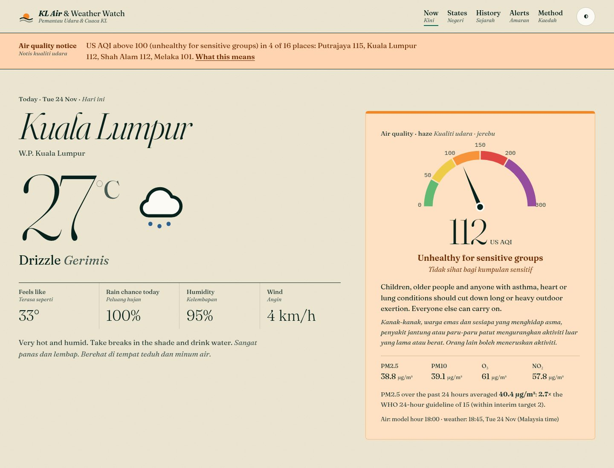

<p align="center"></p>

# KL Air & Weather Watch

[](https://github.com/VinVirtual/kl-air-watch/actions/workflows/test.yml) [](LICENSE) [](DATA-LICENSE.md)

Weather and haze for Kuala Lumpur and every Malaysian state, as a static site that can update itself every three hours for free. Open source: this repository hosts nothing itself. Build it on your machine in a minute, or [deploy your own](#deploy-your-own) on GitHub Pages or Cloudflare Pages.

Each build also writes haze alert feeds (`alerts.xml` RSS, `alerts.json` JSON Feed) and the data behind the pages (`latest.json`, `history.json`).

- **Today in KL**: temperature, feels-like, rain chance, humidity and wind; US AQI on a gauge with the category and plain-language advice in English and Malay; PM2.5, PM10, ozone and NO₂; the past 24 hours' PM2.5 against the WHO guideline.
- **48 hours**: hourly temperature, feels-like and rain chance, and the hourly US AQI over its category bands, as SVG charts drawn at build time, each with a description and a data table.
- **7 days**: highs, lows, rain and (for the three days the air model reaches) the peak AQI.
- **16 places**: KL, the 13 state capitals, Putrajaya and Labuan on a tile map coloured by AQI, a table sorted worst first, and a page each.
- **Haze banner** on every page when any place passes US AQI 100 (notice) or 150 (alert), and an **alert log** with RSS and JSON feeds.
- **History**: one compact summary per place per day, committed to the repository, so the 30-day charts, the all-states grid and the monthly (seasonal) view build up over time.
- Light and dark, phone-friendly, no third-party requests, strict Content-Security-Policy, English first with Malay labels.

Screenshots: [`docs/home-light.jpg`](docs/home-light.jpg), [`docs/home-dark.jpg`](docs/home-dark.jpg), [`docs/home-charts.jpg`](docs/home-charts.jpg), [`docs/home-map.jpg`](docs/home-map.jpg), [`docs/home-phone.jpg`](docs/home-phone.jpg), [`docs/states.jpg`](docs/states.jpg), [`docs/history.jpg`](docs/history.jpg) (dark), [`docs/method.jpg`](docs/method.jpg) (dark).

## Data sources and attribution

| Source | What | Terms |
|---|---|---|
| [Open-Meteo Forecast API](https://open-meteo.com/en/docs) | current weather, hourly and 7-day forecast, Malaysia time | free for non-commercial use, under 10,000 calls a day; data CC BY 4.0 |
| [Open-Meteo Air Quality API](https://open-meteo.com/en/docs/air-quality-api) | PM2.5, PM10, ozone, NO₂, US and European AQI, from the CAMS global forecast (~45 km grid, updated twice a day) | as above; Copernicus data |

Every page says **"Weather data by Open-Meteo.com"** with a link, names the CC BY 4.0 licence, and states "contains modified Copernicus Atmosphere Monitoring Service information". `latest.json`, `history.json` and the RSS feed carry the same attribution.

**Malaysia's official Air Pollutant Index (APIMS, Department of Environment) is not used.** We found no documented public API with reuse terms: the government open-data catalogue lists APIMS with its licence "not specified", and the openly licensed DOE-derived dataset on data.gov.my is monthly. The site links to [APIMS](https://apims.doe.gov.my/) for official readings and explains that a US AQI of 100 and an API of 100 are different scales.

## Quick start

Needs Node 22 or newer. Python 3 is used by one feed test and as a simple web server.

```bash
git clone https://github.com/VinVirtual/kl-air-watch && cd kl-air-watch
./check_env.sh               # says what is missing and how to fix it
./airwatch update            # 2 requests to Open-Meteo; writes data/latest.json, adds finished days to data/history/
./airwatch site              # builds dist/ and checks links, CSP, attribution, size
python3 -m http.server -d dist 8000   # open http://localhost:8000/
```

No network? Build from the recorded example instead: `cp examples/2026-11-24/latest.json data/latest.json && ./airwatch site`.

`./airwatch update --backfill 30` asks for 30 past days once to start the history (this repository was started that way on 24 November 2026). `--offline` replays the local response cache; `--no-cache` skips it.

The site URL is used for canonical links, feeds and link previews. It defaults to `http://localhost:8000/` for local builds. Set your own with the `AIRWATCH_SITE_URL` environment variable or `./airwatch site --site-url https://air.example.org/` (https, ending in `/`).

## Deploy your own

### GitHub Pages (built in)

[`.github/workflows/deploy-pages.yml`](.github/workflows/deploy-pages.yml) fetches, records new history days and alerts, commits the data files, builds the site and publishes it with `actions/deploy-pages`. In this repository it only runs when started by hand, so nothing is hosted from here. In your fork:

1. Fork the repository (public forks get free Actions minutes).
2. Settings, Pages, Source: **GitHub Actions**.
3. Settings, Actions, General, Workflow permissions: **Read and write**, so the workflow can commit `data/history/`.
4. In `deploy-pages.yml`, uncomment the two `schedule` lines (every 3 hours) and push.
5. Actions, deploy-pages, **Run workflow**. Set `backfill` to `30` the first time to start the history.

The history committed here covers 25 October to 24 November 2026. Your fork carries on from the day it first runs; a backfill fills up to 92 days before that.

The site URL comes from GitHub Pages. For a custom domain, set the repository variable `AIRWATCH_SITE_URL` (Settings, Secrets and variables, Actions, Variables), for example `https://air.example.org/`. If you change the schedule, change `RUNS_PER_DAY` in `scripts/lib/config.mjs` too: the update refuses a schedule that could pass Open-Meteo's daily limit, and the Method page shows the numbers.

GitHub can start scheduled runs late or drop them when busy. Every page shows the model hour of its data and when it was built, and after 7 hours it shows a "these numbers are stale" bar.

### Cloudflare Pages (alternative)

Cloudflare Pages also reads the `_headers` file the build writes, so the CSP is sent as a real header with `frame-ancestors 'none'`, `X-Frame-Options: DENY` and `nosniff` (GitHub Pages ignores `_headers`; the pages carry the CSP in a meta tag either way). By hand:

```bash
AIRWATCH_SITE_URL=https://<your-project>.pages.dev/ ./airwatch site
npx wrangler pages deploy dist --project-name <your-project> --branch main
```

To run it on a schedule, keep the build job of `deploy-pages.yml` and swap the upload and deploy steps for [`cloudflare/wrangler-action`](https://github.com/cloudflare/wrangler-action) with `command: pages deploy dist --project-name=<your-project>`, plus repository secrets `CLOUDFLARE_ACCOUNT_ID` and `CLOUDFLARE_API_TOKEN` (a token with Account, Cloudflare Pages, Edit only).

### Cost

Open-Meteo's free API is for non-commercial use, under 10,000 calls a day. Both APIs take all 16 places in **one request each**, so an update is two requests. The forecast request reported `X-RateLimit-Cost: 28.8` calls on 24 November 2026 (the air quality API sends no such header); at 8 updates a day that is about 230 calls a day. The one-off 30-day backfill cost 76 calls. For commercial use, see [Open-Meteo's pricing](https://open-meteo.com/en/pricing).

## How it works

| Stage | File | What happens |
|---|---|---|
| 1. Fetch | `scripts/lib/http.mjs`, `openmeteo.mjs` | two HTTPS GETs to the two allow-listed Open-Meteo hosts; no redirects, size cap, timeout, one retry, a request budget, a generic User-Agent |
| 2. Parse | `openmeteo.mjs` | every response is checked: 16 places in order, coordinates within 1° of the place asked for, Malaysia time, increasing times, matching lengths; values outside plausible ranges become missing and are counted |
| 3. Snapshot | `snapshot.mjs`, `schema.mjs` | now, the next 48 hours (weather joined with air by hour), 7 days, past-24-hour PM2.5 mean, next-24-hour AQI peak; validated before use |
| 4. History | `history.mjs` | every complete past day with at least 20 hours of data becomes one line per month file in `data/history/`; a recorded day is never rewritten |
| 5. Alerts | `alerts.mjs` | banner levels; a log entry per place, day and category at US AQI 151+, or when KL is forecast to reach it within 24 hours |
| 6. Site | `site.mjs`, `render/*.mjs` | 21 static pages, SVG charts with tables, feeds, `latest.json`, `history.json`, `_headers`; the build fails on inline code, a missing CSP or attribution, broken links, or over 6 MB |

Thresholds: US EPA AQI categories; WHO 2021 24-hour guideline (PM2.5 15 µg/m³) and interim targets. Both tables, the schedule and the limits are on the site's Method page, generated from `scripts/lib/config.mjs`.

## The example

[`examples/2026-11-24/`](examples/2026-11-24/) holds the snapshot from a live update at 18:45 Malaysia time on 24 November 2026 (`latest.json`) and the site built from it with the 30 backfilled days (`site/`). That afternoon four places were over US AQI 100: Putrajaya 115, Kuala Lumpur and Shah Alam 112, Melaka 101, so the site shows the amber notice. No place reached 151, so the alert log is empty. In the 30 days before (25 October–23 November), the model put Kuala Lumpur's daily peak above 150 on 3 days.

## Tests

87 unit tests (`npm test`, no network) and 10 browser tests (`npm run test:e2e`, needs Chrome). The unit tests run on the two API responses recorded on 24 November 2026 ([`tests/fixtures/`](tests/fixtures/)) and cover URL building, strict parsing and rejection of malformed or out-of-range data, AQI categories and boundaries, Malay and English advice, the WHO comparison, the snapshot and its validation against tampering, history summaries and merging (never rewriting, month splits, symlinks), alert levels and de-duplication, chart and page rendering with escaping, the site checks, RSS well-formedness (parsed by Python) and JSON Feed fields, the HTTP layer (hosts, redirects, size, retries, budget, cache, offline), the CLI, the workflows (pinned actions, schedule off in this repository, per-job permissions, bot identity for data commits) and a privacy scan of committed files. The browser tests load every page under the CSP with no off-site requests, check fonts, the chart readout, data tables, the theme toggle, 360 px width, landmarks and Malay `lang` attributes, WCAG AA text contrast in both themes (including on AQI colours) and reduced motion.

## Limits

- **Models, not monitors.** Every air number is a CAMS forecast for a grid cell tens of kilometres wide. Local smoke, traffic or valleys can be far worse; the model can miss a whole episode. History is the model's values for past hours, not station measurements.
- **US AQI is not Malaysia's API.** Use APIMS for official decisions.
- **One point per state**, at its capital. KL and Shah Alam can share a grid cell and show the same air.
- **A day's peak AQI can be ozone**, not haze: in this model, afternoon ozone often sets KL's daily peak. PM2.5 is the haze figure.
- **The air forecast reaches 3 days**; days 4–7 show weather only.
- **Malay text** was written for this project and has not been reviewed by a native speaker.

## Contributing

Issues and pull requests are welcome. See [CONTRIBUTING.md](CONTRIBUTING.md).

## Licence

Code: MIT ([`LICENSE`](LICENSE)), copyright Lashvin Manimaran. Data is not covered by the MIT licence: the weather and air quality data in `data/`, `examples/`, `tests/fixtures/` and on the built site come from Open-Meteo under CC BY 4.0 and contain modified Copernicus Atmosphere Monitoring Service information (see [`DATA-LICENSE.md`](DATA-LICENSE.md)). Keep the attribution in the site footer if you publish your own copy. Fonts: Fraunces and IBM Plex Mono, SIL Open Font License 1.1 ([`LICENSE-THIRD-PARTY`](LICENSE-THIRD-PARTY)).
